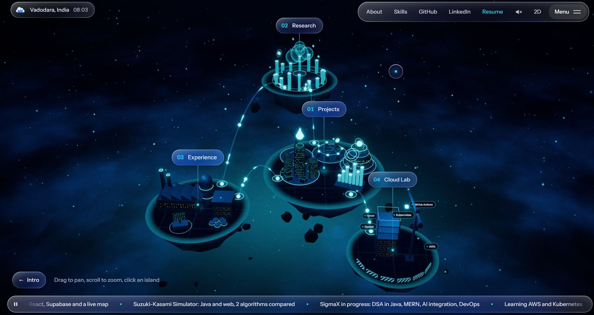
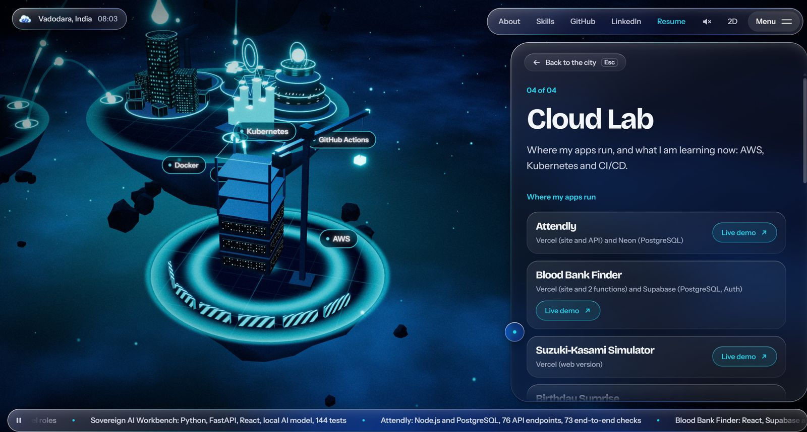
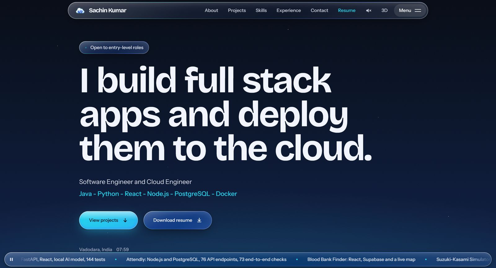
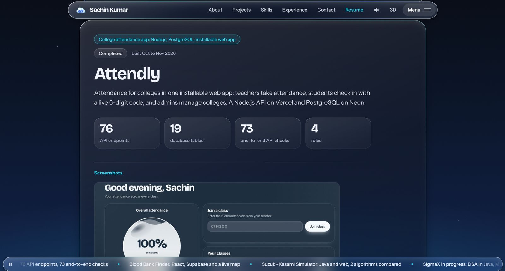
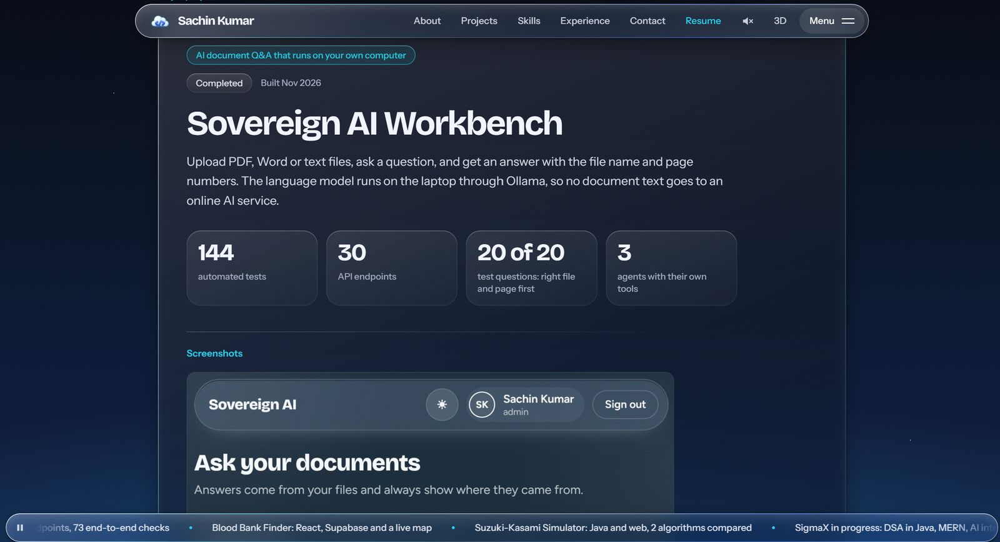
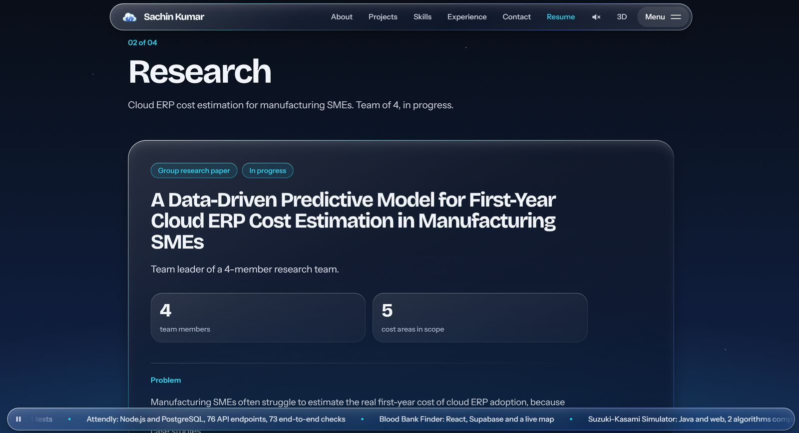
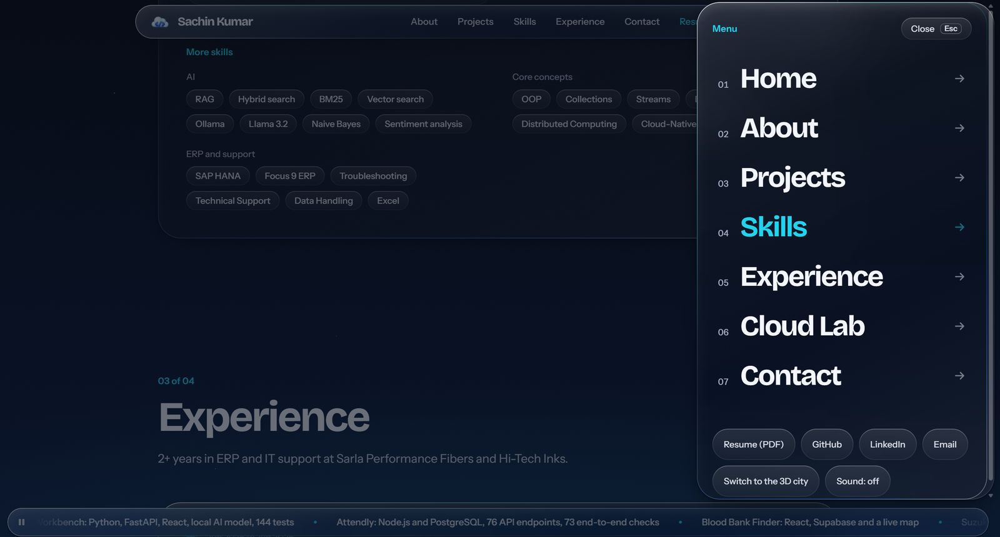

# Cloud City

Portfolio website of Sachin Kumar for recruiters and hiring managers: a 3D city of four islands on laptops, and a 2D page with the same content on phones.

- **Status:** finished
- **Live:** https://sachinkrcodes.vercel.app
- **Built:** November 2026
- **Keywords:** Next.js, React, TypeScript, Three.js, React Three Fiber, WebGL, GLSL, Tailwind CSS, Resend, Vercel

## Highlights

- Built a 3D city of 4 islands with no image or 3D-model files. Every shape is made in code, with 15 hand-written GLSL shaders (sky, clouds, platforms, lines, particles).
- Added automatic quality control: quality drops after 2 seconds under 46 fps and rises after 6 seconds over 57 fps, across 6 steps down to minimal effects at 55% resolution.
- Built a 2D page from the same content file. Phones always get it, also sideways. First visit, empty cache, gzip: 431 kB in 17 requests, against 633 kB in 18 for the 3D city.
- Fixed laggy phone scrolling. On an emulated phone (CPU slowed 4 times, 30 touch swipes) frames over 33 ms went from 27% to 0.2% after blur, film grain and Lenis were turned off on touch screens.
- Skills tags each of 19 skills Used (with its projects) or Learning. Every project has 3 real screenshots, and `npm run build` fails if a screenshot file is missing.

## Screenshots



The 3D city in explore mode: four islands (Projects, Research, Experience, Cloud Lab). Drag to pan, scroll to zoom, click an island and the camera flies to it.



The Cloud Lab island opened. The panel lists where each app runs (Vercel, Neon, Supabase) with a Live demo button, and the island shows Docker, Kubernetes, GitHub Actions, Vercel and AWS.



The 2D page (the 2D button, or `/?mode=lite`): the same content with normal scrolling and no three.js download. Phones get this page by default.



A project case study: Completed status, build dates, four numbers (76 API endpoints, 19 database tables, 73 end-to-end API checks, 4 roles), then screenshots of the app.



Sovereign AI Workbench: 144 automated tests, 30 API endpoints, 20 of 20 test questions with the right file and page first, 3 agents with their own tools.



The Research section: a group paper on cloud ERP cost estimation for manufacturing SMEs. I lead the team of 4. It is still in progress.



The menu: Home, About, Projects, Skills, Experience, Cloud Lab and Contact, plus Resume, GitHub, LinkedIn, Email, the switch to the 3D city and the sound button.

All seven screenshots are of the finished site, taken on a laptop on 18 November 2026.

## Tech

- Next.js 16 (App Router) and TypeScript 5.9: serves the page, renders a plain HTML copy of all content for screen readers and search engines, runs `/api/contact`, builds the link-preview image.
- three.js 0.187 and React Three Fiber 9: draw the 3D city. This code loads only in 3D mode. postprocessing adds bloom, vignette and a film-grain pass. drei is used once, for `Billboard`.
- GLSL: 15 shaders in `src/components/scene/shaders.ts`, wired up in `materials.ts`.
- GSAP 3: camera flights between islands, the loader and the hero animation.
- Lenis 1.3: smooth wheel scrolling on the 2D page and inside the side panel. Off for visitors who ask for reduced motion and on touch screens, where scrolling stays native.
- Zustand 5: one store for the mode, the open panel, the quality step and reduced motion. The 3D scene and the page UI both read it.
- Tailwind CSS 4 and one `globals.css`: all styling, including the glass look. On touch screens the glass is a flat fill, because live blur is what made phones lag.
- Resend: sends the contact form as an email (Formspree works as the other option). The route takes JSON only, 10 KB at most, same-site requests, a honeypot field and 5 messages per 10 minutes per IP.
- Web Audio API: optional sound made in code, off by default, no audio files.
- Vercel (Hobby plan): hosting.

## Run it

- Needs: Node.js 20.9 or newer, npm
- Tested on: Node 22 and npm 10 on Linux, from a fresh clone. Browser checks ran in headless Chromium.

```bash
git clone https://github.com/sachinkrcodes/portfolio.git
cd portfolio
npm ci
npm run dev
```

Then open `http://localhost:3000`.

- Production build: `npm run build`, then `npm run start`. Type check: `npm run typecheck`.
- Contact form: copy `.env.example` to `.env.local` and set `RESEND_API_KEY` (or `FORMSPREE_ID`). Without one of them the form says it is not connected, and the rest of the site works.
- URL switches: `?mode=lite` or `?mode=3d` picks the 2D page or the 3D city. `?perf=2`, `?perf=1` or `?perf=0` pins a quality step.
- How to change the words, set up the contact form and deploy: [docs/GUIDE.md](docs/GUIDE.md).

## Hardest problem

- Problem: for about 1 second after a wheel scroll (measured 0.9 to 1.3 s), none of the 7 scroll keys worked: End, Home, Page Up, Page Down, Space, Arrow Up, Arrow Down.
- Measured: plain Lenis, 300 px wheel scroll from 2,000 px, then a key after 120 ms. All 7 keys ended at 2,300 px, the wheel's target.
- Cause: while gliding, Lenis ignores the browser's own scroll events (`onNativeScroll` in lenis 1.3.27) and keeps pulling the page to its old target.
- Fixed by: `src/lib/useSmoothScroll.ts` calls `lenis.stop()` and then `lenis.start()` on those keys. That resets Lenis to the real scroll position.
- Also covers: find in page and dragging the scrollbar. The same reset runs when the page is 4 px or more from where Lenis put it.
- Result: the same test on the built site (`npm run start`) passes for all 7 keys. End reaches the bottom (13,490 px), Home the top (0 px), and the other 5 move the page from where it was.
- Learned: while a smooth-scroll library glides, it owns the scroll position. Any other way of scrolling has to reset it first.

## Limits and next

- Not done: the contact form's rate limit is kept in server memory, so on Vercel it counts per server instance, not for the whole site.
- Not tested: real phones. The phone numbers above come from an emulated phone with the CPU slowed 4 times, so a real phone will give different numbers.
- Next: move a skill from Learning to Used in `skillTracks` (`src/data/content.ts`) on the day a project ships with it.

## Author

Sachin Kumar | [GitHub](https://github.com/sachinkrcodes) | [LinkedIn](https://www.linkedin.com/in/sachinkrcodes) | sachinkrcodes@gmail.com

MIT License. See [LICENSE](LICENSE).
