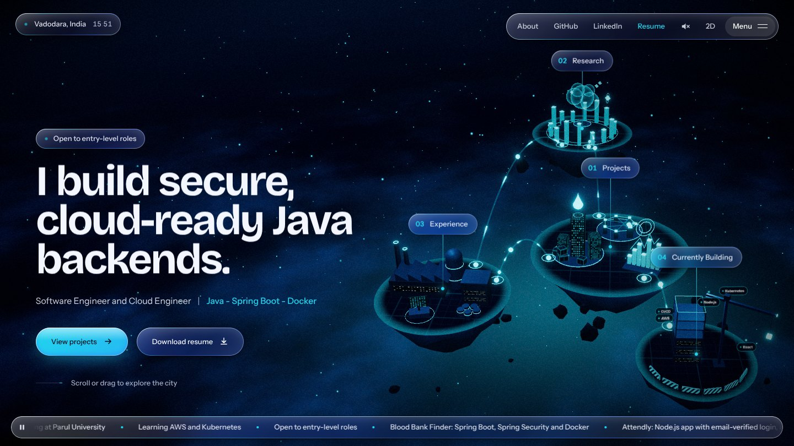
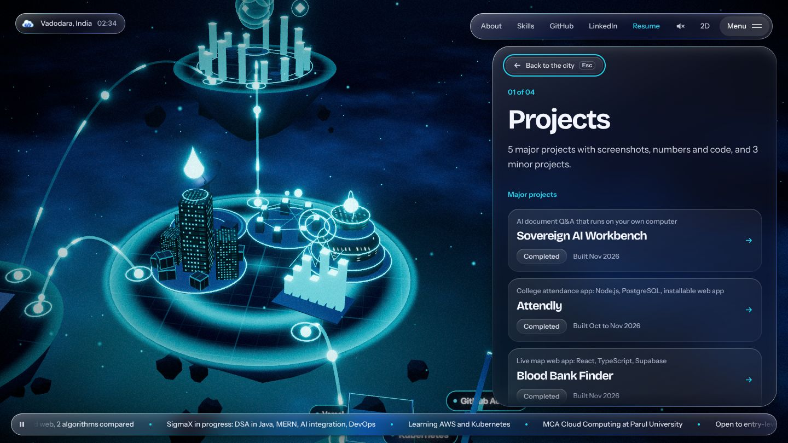
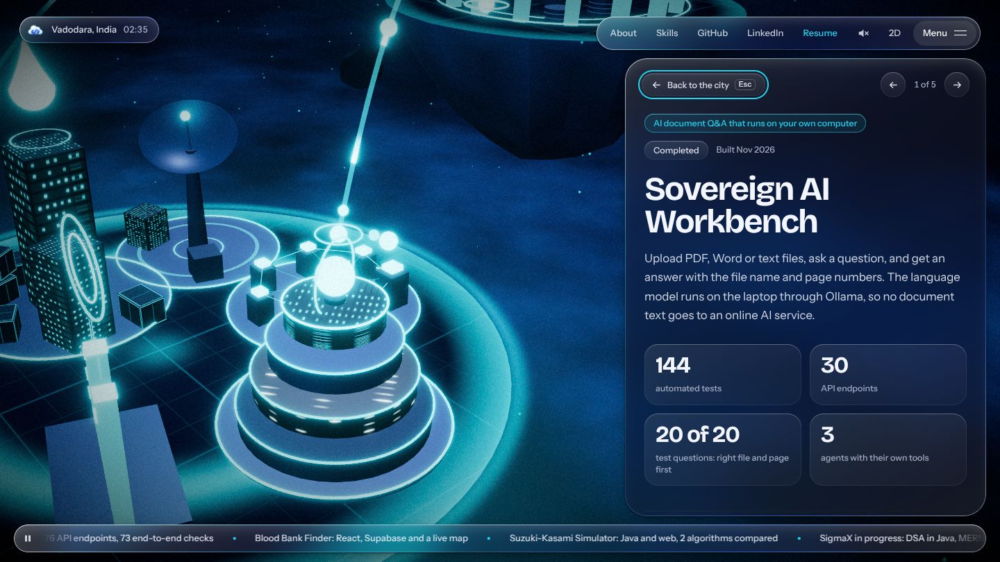
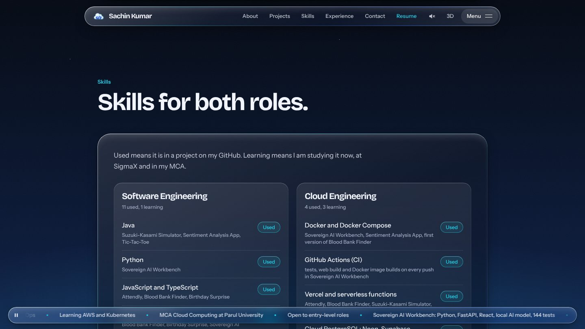
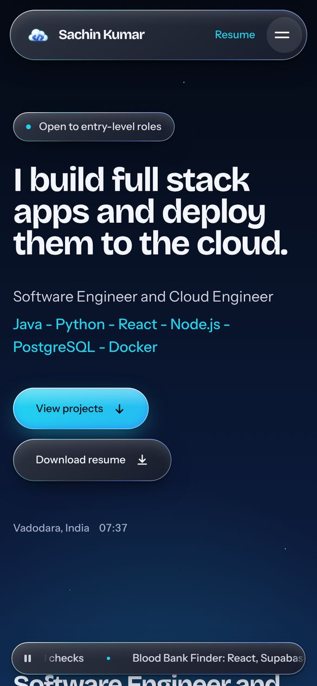

# Cloud City

Portfolio website of Sachin Kumar for recruiters and hiring managers: a 3D city of four islands on laptops, and a 2D page with the same content on phones.

- **Status:** finished
- **Live:** [sachinkrcodes.vercel.app]
- **Built:** November 2026
- **Keywords:** Next.js, React, TypeScript, Three.js, React Three Fiber, WebGL, GLSL, Tailwind CSS, Resend, Vercel

## Highlights

- Built a 3D city of 4 islands with no image or 3D-model files. Every shape is made in code, with 15 hand-written GLSL shaders (sky, clouds, platforms, lines, particles).
- Added automatic quality control: quality drops after 2 seconds under 46 fps and rises after 6 seconds over 57 fps, across 6 steps down to minimal effects at 55% resolution.
- Built a 2D page from the same content file. It is the default on phones, without WebGL2, and on machines with 2 or fewer CPU cores or 2 GB of memory.
- Measured the first visit with an empty cache: the 2D page sends 305 kB in 16 requests, the 3D city 584 kB, because three.js loads only in 3D mode (headless Chromium, `npm run start`, gzip).
- Wrote the contact form's server route: JSON only, 10 KB limit, same-site check, honeypot field, 5 messages per 10 minutes per IP, then sends through Resend or Formspree.

## Screenshots



The 3D city after the loader. Click an island, or use the menu, and the camera flies to it.



The Projects island opens a side panel with 3 case studies and 2 smaller projects.



One case study. The left and right arrow keys move to the previous and next project, and Esc closes the panel.



The 2D page (`/?mode=lite`): the same content with normal scrolling, and no three.js download.



The phone view (390 x 844 px). The 2D page is the default here.

All five screenshots are from `npm run start`, taken in headless Chromium with software WebGL.

## Tech

- Next.js 16 (App Router) and TypeScript 5.9: serves the page, renders a plain HTML copy of all content for screen readers and search engines, runs `/api/contact`, builds the link-preview image.
- three.js 0.187 and React Three Fiber 9: draw the 3D city. This code loads only in 3D mode. postprocessing adds bloom, vignette and a film-grain pass. drei is used once, for `Billboard`.
- GLSL: 15 shaders in `src/components/scene/shaders.ts`, wired up in `materials.ts`.
- GSAP 3: camera flights between islands, the loader and the hero animation.
- Lenis 1.3: smooth wheel scrolling on the 2D page and inside the side panel. Off for visitors who ask for reduced motion. Touch scrolling stays native.
- Zustand 5: one store for the mode, the open panel, the quality step and reduced motion. The 3D scene and the page UI both read it.
- Tailwind CSS 4 and one `globals.css`: all styling, including the glass look.
- Resend: sends the contact form as an email. Formspree works as the other option.
- Web Audio API: optional sound made in code, off by default, no audio files.
- Vercel (Hobby plan): hosting.

## Run it

- Needs: Node.js 20.9 or newer, npm
- Tested on: Node 22 and npm 10 on Linux, from a fresh clone. Browser checks ran in headless Chromium.

```bash
git clone https://github.com/sachinkrcodes/portfolio.git
cd portfolio
npm ci
npm run dev
```

Then open `http://localhost:3000`.

- Production build: `npm run build`, then `npm run start`. Type check: `npm run typecheck`.
- Contact form: copy `.env.example` to `.env.local` and set `RESEND_API_KEY` (or `FORMSPREE_ID`). Without one of them the form says it is not connected, and the rest of the site works.
- URL switches: `?mode=lite` or `?mode=3d` picks the 2D page or the 3D city. `?perf=2`, `?perf=1` or `?perf=0` pins a quality step.
- How to change the words, set up the contact form and deploy: [docs/GUIDE.md](docs/GUIDE.md).

## Hardest problem

- Problem: for about 1 second after a wheel scroll (measured 0.9 to 1.3 s), none of the 7 scroll keys worked: End, Home, Page Up, Page Down, Space, Arrow Up, Arrow Down.
- Measured: plain Lenis, 300 px wheel scroll from 2,000 px, then a key after 120 ms. All 7 keys ended at 2,300 px, the wheel's target.
- Cause: while gliding, Lenis ignores the browser's own scroll events (`onNativeScroll` in lenis 1.3.27) and keeps pulling the page to its old target.
- Fixed by: `src/lib/useSmoothScroll.ts` calls `lenis.stop()` and then `lenis.start()` on those keys. That resets Lenis to the real scroll position.
- Also covers: find in page and dragging the scrollbar. The same reset runs when the page is 4 px or more from where Lenis put it.
- Result: the same test on the built site (`npm run start`) passes for all 7 keys. End reaches the bottom (13,490 px), Home the top (0 px), and the other 5 move the page from where it was.
- Learned: while a smooth-scroll library glides, it owns the scroll position. Any other way of scrolling has to reset it first.

## Limits and next

- Not done: the contact form's rate limit is kept in server memory, so on Vercel it counts per server instance, not for the whole site.               
## Author

Sachin Kumar | [GitHub](https://github.com/sachinkrcodes) | [LinkedIn](https://www.linkedin.com/in/sachinkrcodes) | sachinkrcodes@gmail.com

MIT License. See [LICENSE](LICENSE).
